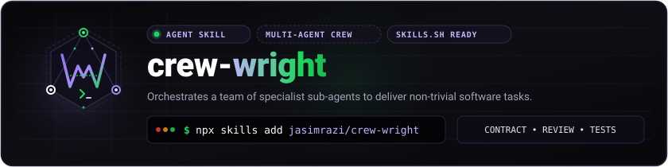
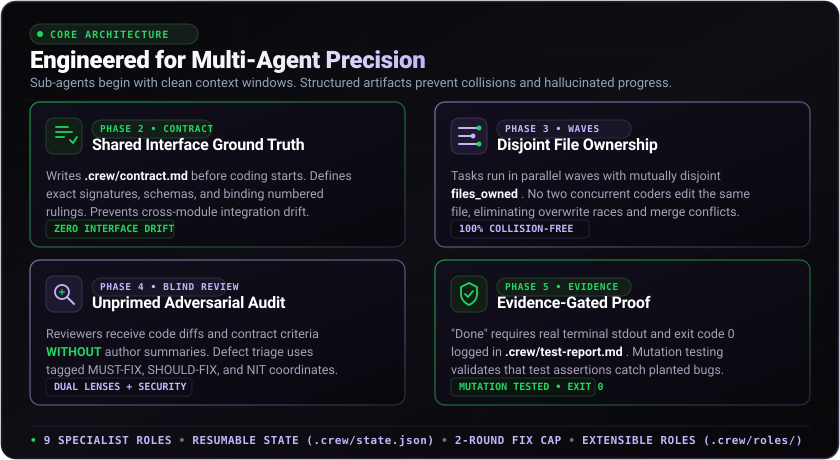
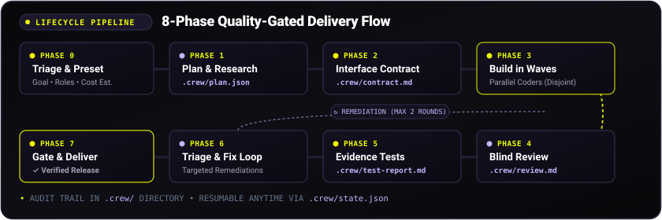

<p align="center">
  
</p>

# crew-wright: multi-agent orchestration skill for Claude Code, Codex and AI coding agents

[](LICENSE)
[](skills/crew-wright/SKILL.md)

**`crew-wright` is an open-source agent skill that turns one AI coding agent into a coordinated team of specialist sub-agents.** Instead of relying on a single context window to juggle architecture, implementation, code review and testing at once, it breaks the goal into bounded task waves and assigns specialized roles: planners, designers, modular coders, blind reviewers, testers and security reviewers. Parallel agents share a binding contract, own separate files, and nothing is marked done until the tests have actually been run and the real output recorded.

> **Why the name?** A *wright* is a builder or craftsman, like a playwright who crafts plays or a shipwright who builds vessels. `crew-wright` builds and runs a crew tailored to your software task.
>
> **Independence notice:** `crew-wright` is an independent, open-source project. It is not affiliated with, sponsored by, or associated with CrewAI Inc. or any other "crew" framework.

<p align="center">
  
</p>

---

## Install crew-wright

Install `crew-wright` into your coding agent with the [skills CLI](https://www.npmjs.com/package/skills), which finds the skill definition in a GitHub repo or a local path:

```bash
# Install to your current project
npx skills add <YOUR-GITHUB-USER>/crew-wright

# Install globally for all projects (-g)
npx skills add <YOUR-GITHUB-USER>/crew-wright -g

# Install only the crew-wright skill from a multi-skill repository
npx skills add <YOUR-GITHUB-USER>/crew-wright@crew-wright

# Test or install locally from source
npx skills add ./skills/crew-wright

# Confirm it is installed
npx skills list
```

It works with coding agents the skills CLI supports, such as **Claude Code** and **Codex**, and with other tools that follow the [Agent Skills](https://agentskills.io) `SKILL.md` format.

---

## How to use crew-wright: example prompts

The skill activates when a task needs coordination, planning and multi-pass checking. Prompts like these trigger it naturally:

1. *"Assemble a crew of specialist agents to build a high-performance Markdown table formatter CLI in TypeScript with full test coverage."*
2. *"Run a multi-agent team to implement token-based authentication and rate limiting for our Express REST API. Do a blind review and security audit before declaring done."*
3. *"Plan, build, review, and test a responsive customer checkout form with client-side validation using parallel sub-agents."*

*(For quick one-line bug fixes or single-file changes, the skill steps aside to avoid unnecessary coordination overhead.)*

---

## How the multi-agent workflow works: 8 phases

`crew-wright` moves through 8 phases to keep quality high and stop parallel agents from colliding:

<p align="center">
  
</p>

```text
+-------------------------------------------------------------------------+
| Phase 0: Triage                                                         |
| - Clarify goal (max 1 question) & pick preset (small / medium / large)  |
| - Scan for custom roles in .crew/roles/ & check resumable state         |
| - Present planned roles & cost estimate; obtain user confirmation       |
+-------------------------------------------------------------------------+
                                    |
                                    v
+-------------------------------------------------------------------------+
| Phase 1: Plan & Research                                                |
| - Spawn Planner (and parallel Researcher if libraries are unfamiliar)   |
| - Produce .crew/plan.json with disjoint file ownership across tasks     |
| - Validate: zero shared files in same wave, no cycles, actionable AC    |
+-------------------------------------------------------------------------+
                                    |
                                    v
+-------------------------------------------------------------------------+
| Phase 2: Interface Contract                                             |
| - Populate .crew/contract.md (shared interfaces, schemas, rulings)      |
| - Numbered rulings log resolves ambiguities; all sub-agents read this   |
+-------------------------------------------------------------------------+
                                    |
                                    v
+-------------------------------------------------------------------------+
| Phase 3: Wave-Based Build                                               |
| - Group tasks into dependency waves; launch wave agents in parallel     |
| - Enforce strict 5-part brief with file boundaries (files_owned)        |
| - Verify outputs (files exist, code compiles) after each wave           |
| - Integrator wires modules in large builds                              |
+-------------------------------------------------------------------------+
                                    |
                                    v
+-------------------------------------------------------------------------+
| Phase 4: Blind Review                                                   |
| - Reviewer inspects diff & contract WITHOUT coder self-summaries        |
| - Large preset: 2 reviewers with different lenses (correctness vs arch) |
| - Security reviewer inspects auth, payments, shell/SQL, and inputs      |
| - Findings tagged MUST-FIX / SHOULD-FIX / NIT with file coordinates     |
+-------------------------------------------------------------------------+
                                    |
                                    v
+-------------------------------------------------------------------------+
| Phase 5: Evidence-Gated Testing                                         |
| - Tester writes & executes tests; logs raw output to test-report.md     |
| - "Done" requires real command output and exit code 0                   |
| - Orchestrator re-runs test command independently to verify evidence    |
| - Large preset: test-the-tests check (proves tests catch planted bugs)  |
+-------------------------------------------------------------------------+
                                    |
                                    v
+-------------------------------------------------------------------------+
| Phase 6: Fix Loop (Capped at 2 Rounds)                                  |
| - Triage MUST-FIX issues to responsible coders by file ownership        |
| - Re-test; stop and report if issues persist after 2 rounds             |
+-------------------------------------------------------------------------+
                                    |
                                    v
+-------------------------------------------------------------------------+
| Phase 7: Gate & Delivery                                                |
| - Release checklist sign-off: AC met, tests green, zero open MUST-FIX   |
| - One clean merged delivery summary with test proof; no agent log dumps |
+-------------------------------------------------------------------------+
```

---

## Presets: small, medium and large crews

`crew-wright` describes models as three generic tiers instead of naming vendors: **Strong** (planning, blind review, security), **Standard** (coding, interface design, testing, docs) and **Cheap** (research and routine lookups).

| Preset | Target scope | Active specialist roles | Typical parallel agents |
| :--- | :--- | :--- | :--- |
| **Small** | 1–3 files, focused components, small utilities | Planner (inline), 1 Coder, 1 Tester | 1–2 |
| **Medium** | 3–10 files, standalone features, standard REST APIs | Planner, Designer, Coders (by module), 1 Reviewer, 1 Tester | 2–4 per wave |
| **Large** | Full systems, multi-module apps, auth and security surfaces | Planner, Researcher, Designer, Coders (by module), Integrator, 2 Blind Reviewers, Security, Tester, Docs | 4–8 per wave |

*A crew run costs several times the tokens of a single pass, and the cost grows with the preset, so measure it on your own tasks. For Medium and Large runs, the orchestrator tells you the planned roles and rough cost and asks for confirmation before spawning sub-agents.*

---

## Add custom agent roles (`.crew/roles/`)

Need a database administrator, performance benchmarker or compliance reviewer? Override the standard roles or add new specialists with markdown files in `.crew/roles/`:

```text
my-project/
└── .crew/
    └── roles/
        ├── reviewer.md       # Overrides the default blind reviewer
        └── dba.md            # Adds a custom DBA role
```

Each role brief should define:
1. **Objective**: exactly one primary goal.
2. **Context**: paths to `.crew/contract.md` and relevant code, not pasted file contents.
3. **Boundaries**: an explicit list of `files_owned`.
4. **Output contract**: capped at about 200 words plus modified file paths.
5. **Honesty clause**: report unverified assumptions and failures.

The orchestrator scans `.crew/roles/` during Phase 0 (triage).

---

## Resume an interrupted run

Coordination state is saved in `.crew/state.json`. If your terminal disconnects or you pause a run, `crew-wright` finds the saved state on relaunch and offers to resume from the active wave without repeating completed work.

---

## How crew-wright compares to other multi-agent tools

Several good projects tackle multi-agent coding, and the right choice depends on your needs.

| Project | Focus |
| :--- | :--- |
| [am-will/swarms](https://github.com/am-will/swarms) | Dependency-aware planning, then parallel waves of sub-agents |
| [RatherN-t/workflow-skill](https://github.com/RatherN-t/workflow-skill) | Plan, parallel build, adversarial review, test and a readiness gate |
| [rjmurillo/ai-agents](https://github.com/rjmurillo/ai-agents) | A large toolkit of agent roles, lifecycle commands and governance gates |
| **`crew-wright`** | A compact skill built around file ownership, a shared contract, blind review and evidence-gated testing, with user-defined roles |

`crew-wright` is not a framework or runtime like CrewAI, AutoGen or LangGraph. It is a skill that your existing coding agent follows.

---

## Evals

The `evals/` directory contains 3 realistic evaluation cases:
- `evals/cases/case-1-cli-table/`: CLI tool parsing stdin or files, with alignment and sorting.
- `evals/cases/case-2-auth-api/`: REST API with bearer-token authentication and payload validation.
- `evals/cases/case-3-form-validator/`: interactive form with separate validation logic and accessible error states.

Check a finished workspace against a case's assertions:
```bash
node evals/evaluate.js --case case-1-cli-table --workspace /path/to/workspace
```
See [evals/README.md](evals/README.md) for how to compare runs with and without the skill.

---

## FAQ

**Does crew-wright work with Claude Code?** Yes. Claude Code supports sub-agents and the Agent Skills format. See [references/adapters.md](skills/crew-wright/references/adapters.md) for the mapping.

**What if my agent has no sub-agents?** `crew-wright` runs the roles one after another in a single session and writes the same `.crew/` files.

**How do parallel agents avoid overwriting each other?** Every task declares `files_owned`, and the orchestrator checks that no file belongs to two tasks in the same wave before work starts.

**What is blind review?** The reviewer gets the contract, acceptance criteria and code, but not the coder's summary, so it judges the work without the author's framing.

**Is it free?** Yes, it is MIT licensed. You pay only for the model usage of the agent you run it in.

---

## Limitations

- **Sub-agent support varies.** Parallel waves need an agent with sub-agents. Otherwise roles run sequentially (see [references/adapters.md](skills/crew-wright/references/adapters.md)).
- **Higher token use.** Planning, blind review, security review and test generation cost more than a single prompt. Use the small preset, or no crew, for simple work.
- **Needs a runnable test setup.** Evidence-gated testing requires the relevant runtime (for example `node`, `python` or `cargo`) on the machine to capture real exit codes.
- **No guarantees.** Reviews and tests lower the risk of defects but do not remove it.

---

## Repository structure

```text
crew-wright/
├── README.md                      # Documentation and quick start
├── LICENSE                        # MIT License (2026)
├── assets/
│   ├── logo.svg                   # Header banner logo
│   ├── logo-icon.svg              # Standalone icon
│   ├── features.svg               # Architecture and core pillars graphic
│   └── workflow.svg               # 8-phase pipeline graphic
├── skills/
│   └── crew-wright/
│       ├── SKILL.md               # Main orchestrator (under 500 lines)
│       └── references/
│           ├── roles.md           # Brief templates for all 9 roles
│           ├── contract-template.md # Template for shared contract
│           ├── presets.md         # Small / Medium / Large presets & tiers
│           └── adapters.md        # Mappings for agent harnesses
├── evals/
│   ├── cases/                     # 3 test cases with prompt.md & case.yaml
│   │   ├── case-1-cli-table/
│   │   ├── case-2-auth-api/
│   │   └── case-3-form-validator/
│   ├── evaluate.js                # Assertion verifier script
│   └── README.md                  # Benchmark methodology
└── examples/
    └── example-run.md             # Walkthrough with .crew/ artifacts
```

---

## License

MIT License. Copyright (c) 2026 crew-wright contributors. See [LICENSE](LICENSE) for details.